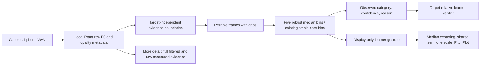

# Pronunciation consistency pass — 2026-09-25

**Outcome: primary visualization now uses the robust acoustic summary judged by Benma. No acoustic categories, confidence levels, reasons, thresholds, selected regions or Praat settings changed.** Fresh results remain **Matches / Unclear / Unclear / Close** for 妈 / 马 / 骂 / 天. Certified short-gap display is integrated; detailed filtered/raw views preserve measured evidence. Ready for a reviewed development checkpoint, with the limitations below. No commit or paid provider call occurred; the feedback UI milestone and performance optimization were not started.

Work stays on `pronunciation-calibration`, committed baseline `a8bdfab3d00365c00e1a10881e8999df63f2823c`. Existing validated uncommitted work was retained. Comparisons use the **pre-pass working tree**, not the older committed baseline. Database access used a read-only transaction; canonical audio copies remain under `/tmp`.

## Exact fresh identities

All dates are September 25, 2026. UTC−4 = EDT. Target IDs, attempt creation order and perceptions independently match the reported screenshots. 钱 includes persisted punctuation; no prior calibration recording was substituted.

| Target | Attempt | Utterance | Target ID | Created UTC (EDT clock) | Perception |
|---|---|---|---|---|---|
| 妈 mā | `e33f2799-3520-4825-89f6-0b8bd0dcb7b4` | `aa2a24d6-3540-437c-9f5a-4641c4f783a5` | `9cfde8c5-ac57-43b4-924d-08a8c34944e0` | 18:55:14.494917 (14:55:14.494917) | 妈 |
| 马 mǎ | `8734dbd4-4165-4fa8-99d3-60ad72d3cfa0` | `b0b7493d-bbff-40d1-9676-a37d19c8f344` | `991c9b7f-ca58-44f7-bc80-1e87f34e33d0` | 18:55:55.617306 (14:55:55.617306) | 妈 |
| 骂 mà | `eaa1184d-5d15-485d-8eae-8f85321960ea` | `17fb6827-327f-49f0-b1c4-2ad232fee61b` | `6047aac1-0b5b-4823-a522-80741bbbea88` | 18:56:24.153727 (14:56:24.153727) | 嘛 |
| 天 tiān | `9e521283-c96d-4e76-80d8-f0e9fae9d472` | `3803ceff-62e0-46c6-8015-b4131d8f2f1b` | `ce32aa3d-5c5a-4e1e-9c8f-5468260bcb78` | 18:56:46.067975 (14:56:46.067975) | 钱。 |

[Fresh diagnostics](fresh-diagnostics.json) preserve the pre-change read-only API projection and diagnostic output. [Acoustic traces](acoustic-traces.json) contain post-change diagnostic features, full filtered samples and raw aligned-window samples; [display traces](display-traces.json) contain actual old/new TypeScript output and geometry. The pre-change diagnostic keys describing the primary graph refer to the old implementation; the diagnostic command now explicitly separates the broad summary from its measured fallback.

## Architecture and representation contract

The [audit written before implementation](architecture-before.md) describes samples, centering, smoothing, timestamps, gaps and grading authority at every stage.

Raw includes missing/rejected evidence and original times; reliable processing retains existing quality filters and within-segment median-of-three smoothing. Equal-count classifier medians summarize retained selected evidence. The onset hypothesis already computes separate stable-core bins; those are now exposed too. Grading continues to read raw-derived reliable evidence, ignoring the compatibility display argument. No arrow returns from primary display to classification.

**Option A chosen:** frontend projects existing numeric `ObservedContour.features` into `learnerGestureContour`, method `classifier-bin-gesture-v1`. Backend adds representative median timestamps and already-computed core medians to that extensible diagnostic dictionary. No new schema field or duplicated classifier math. A direct polyline keeps every median exact. A smoothed curve would introduce ungraded amplitude changes or overshoot; independently downsampling frames would recreate the source mismatch. Bin times are representative centers, not measured F0 frames. Rendering joins them only as an explicitly broad summary.

Amplitude is unchanged except median recentering. Extent is at least ±4 st and expands only to avoid clipping larger movement. Expected prototypes use the same extent: prototype height unit =6 st; Tone-2 prototype rises 3 st, Tone-4 falls 6 st. Mine is never stretched independently to fill the box, and the detail explanation states exact overlap is not required. No target or expected prototype enters the gesture helper. Classification labels only help recognize the explicit backend gap certificate; they do not choose pitch values, direction, smoothing or an ideal shape.

Legacy/missing summaries fall back to the existing measured contour. Uncertified gaps retain segmented measured fallback. Therefore “broad pitch” remains an approximate display, and uncertain results include a reason and “No confident tone judgment.” No graph is promoted to a tone decision by its appearance.

**More detail:** known-target whole-utterance `display_contour` now returns every retained filtered frame, removing the previous .15-st transport simplification for this detail view. Raw graph reads full `f0`, with `mobile_f0` only as legacy fallback. Neither passes through primary normalization/bridging. Original raw evidence is never mutated or persisted again. Whole contour, raw pitch, excluded-boundary counts, retained-core/selected interval timestamps, gaps, confidence, reason, recording quality and fixture provenance remain accessible. The compact syllable fallback can still use the existing simplified transport.

## Fresh 妈: why graph and text disagreed

Aligned .37–1.21 s; all 58 retained frames at .4843–1.0543 s form one .58-s core. No evidence-region exclusion, gaps, contamination, large-jump rejection or onset-core hypothesis. Bins:

`[-0.2756, -0.7847, 0.1546, 0.5314, -0.9229]`

Representative times: `[.5343, .6493, .7643, .8793, .9993]` s. Robust range **1.4544 st**, net **−.6473 st**, broad path **3.2795 st**. Existing level conditions range≤1.5 and |net|≤1 pass. Residual p90 raw/reliable **.0989/.0989 st**, mean raw/filter disagreement **.0053 st**; coverage 1.0 in active core and boundary-tolerant view, .6905 in full alignment. Thus `1-like / moderate / acoustic_shape_only → matches`.

Raw voiced range **5.358506 st**; reliable frame range **5.2764 st**, frame path **11.2746 st**. The old API simplified this to 17 primary vertices, preserving the large early descent, trough, recovery and terminal fall. The old frontend low-pass reduced range only to **5.25662 st**. Domain was **[−4,+4]** already: this was not tiny-amplitude auto-stretching. A 38-pixel vertical plotting area rendered about **24.968945 px** movement. New exact-bin range is **1.4543 st** after four-decimal feature rounding (classifier reports 1.4544 from unrounded medians), occupying **6.907925 px**, with the same domain.

The excursions are measured selected F0, including onset/offset movement, not fabricated curve artifacts. Maximum local raw jump is 1.2904 st; independent high-pass comparison differs by at most .04705 st over voiced frames. Median periodicity is .96555; onset/offset strengths are lower. This supports a real measured trajectory rather than an isolated octave branch, but does not establish physiological ground truth. The classifier discounts these excursions through broad robust bins. **The contradiction was primarily graph-source abstraction mismatch, not evidence selection, vertical normalization or smoothing.** The new graph retains small broad bends; it is not flattened into the expected Tone-1 line.

## Fresh 马: exact rejection retained

Aligned .45–1.17 s; 49 retained raw voiced frames at .5324–1.0124 s, .49-s continuous core; no boundary selection, gaps, contamination, tracker veto or discarded voiced frames.

| Feature | Value |
|---|---:|
| Five bins | [.1574, −1.1528, −.5714, 1.8583, .4466] |
| Low index / position | 1 (zero-based) / .25 |
| Fall / final recovery | 1.3102 / 1.5995 st |
| Net / range / path | +.2893 / 3.0111 / 5.7331 st |
| Final reversal, bin 4→5 | −1.4117 st |
| Raw / filtered frame range | 3.559176 / 3.4549 st |
| Reliable / raw residual p90 | .0646 / .1598 st |
| Mean raw/filter disagreement | .0122 st |
| Full / active / boundary coverage | .6806 / 1 / 1 |

Quality and broad-path noise gates pass (path 5.7331≤2.2×range≈6.6244). Level fails range; rise fails net≥2 and path/net; canonical valley fails fall≥1.5. Shallow fallback fails **central low_index=2**, **strictly increasing recovery**, and **fall≥25% of movement** (1.3102<1.433275). Falling fails negative net. It remains `unclear / low / ambiguous_shape`.

The earlier accepted shallow valley had a central trough and clean two-limb progression. Here the early trough plus 1.41-st terminal reversal is not a small terminal wiggle; almost half of its 3.01-st span reverses again. The available convenience corpus does not justify replacing the shallow-valley model from this example. **No Tone-3 logic changed**, no extra fallback was added, and no Tone-2/3 labels changed. An intended Tone 3 remains plausible, but intent and graph appearance are insufficient to certify it.

## Fresh 骂: shallow supported fall, not the prior gap case

Aligned .43–.86 s; all 14 voiced observations at .523–.653 s survive filtering. Bins **[1.0557,.5503,.0073,−.5279,−.7519]**. Net/range/path **−1.8076 /1.8076 /1.8076 st**; raw/reliable frame range **1.957957 /1.8907 st**. Reliable/raw residual p90 **.085/.1342 st**; mean disagreement **.0069 st**. Voiced/core duration **.14/.14 s**, full/core/boundary coverage **.3256/1/.7487**. Gap count, gap duration, discontinuous count and certificate all **0**. No contamination, tracker instability, frame exclusion or selected boundary region.

All ordinary quality gates pass. Level fails range and |net|; Tone 4 fails the **−2-st** broad-change threshold. Short-coherent-fall is only eligible for .10≤voiced duration<.12 s; this .14-s take does not qualify. Its minimum periodicity .488 also fails that exception's ≥.55-all-frames condition. Result remains `unclear / low / ambiguous_shape`. This is observable downward movement, but too shallow for the current category rule. **No Tone-4 or gap classifier changed.** The special short-fall duration boundary is documented, not broadened from one intended example.

After .653 s, 20 aligned frames have no selected F0; none has tracker_f0 either. The first four retain energy (maximum RMS .013005), then energy fades below gate. Thus the core ends with missing periodic pitch, not a rejected supported continuation or a second voiced limb. No measured later fall can be recovered from those frames. ASR/alignment did not choose the acoustic slope, and no existing quality veto secretly changed a supported Tone-4 label. We cannot establish whether untracked terminal phonation contained further movement.

## Fresh 天: Close is intentional

Aligned .51–1.03 s; reliable selected-region frames .6547–.8947 s, 25 frames/.25 s. Ordinary bins **[.3016,−.2870,0,.1894,−.0334]**, range .5886 st. The existing onset-core rule finds a stable tail after two frames, .6747–.8947 s, 23 frames/.23 s. Actual core bins now exposed: **[−.3958,−.2321,.0755,.1894,−.0334]**. Onset displacement **2.2298 st**; raw/reliable residual p90 **.2475**, disagreement .005. No core gap or quality veto. Full coverage .4808, active/boundary coverage 1.0.

`1-like / low / sustained_level_after_onset` passes the learner reason/quality checks; expected tone agrees and confidence is low, so `learnerVerdict()` returns **Close**, not Matches. This low confidence is the hypothesis's conservative semantics, not a graph-flatness test. New primary uses the actual stable-tail bins, not the whole-span generic bins. No confidence promotion occurred.

ASR perceived **钱。**. It is perception evidence, not proof of a /t/→/q/ substitution. Target assessment is replay, while Azure alignment supplies a reference `tian 1` label; neither provides a live segmental judgment for this take. See the [segmental architecture audit](segmental-audit.md) for exact Azure/iFLYTEK/Tencent normalization, mobile exposure, persistence and missing validation. Azure can provide target-relative phone accuracy when run live, but this branch has no calibrated initial/final mapping or trustworthy Sounds grade. No Sounds card was implemented.

## Certified short-gap display

The prior accepted `701bdfcb-f014-4522-80f2-de5005a8db6c` remains `4-like / low / coherent_short_gap`. Previously the moderate/high-confidence bridge condition and zero-discontinuity requirement made this certificate unusable in display. Now the primary accepts the explicit reason + certificate + exactly one discontinuity/gap, clear quality metadata, ≤40-ms actual endpoint interval, same-direction bin/endpoint/limb geometry, and the backend's low-confidence rising/falling category. Geometry is defensive validation of the certificate, not a substitute certificate. The primary can connect five robust bins; normalization also supports the certified measured fallback. Long, contradictory, extra, uncertified and contaminated gaps fail closed. More detail still has the actual two segments and raw missing frames. No samples are inserted into grading or persisted.

## Corpus and invariants

Comparable current human calibration corpus: **55 recordings /97 numerical spans /91 timing-authorized /6 timing-rejected** (previous 51/93 plus these four). A complete acoustic-record inventory finds **63 persisted recordings /112 syllable rows**; eight older recordings have **15 rows without numerical timing**, and three of those eight have no Mandarin syllable rows. These were absent from the previous timed-corpus count. They remain unavailable; no synthetic interval or pilot label was invented. [Inventory](corpus-inventory.json), [summary](summary.json), [full recomputation](recomputation.json), [actual TypeScript verdicts](learner-recomputation.json).

**Every changed acoustic label: none. Every changed confidence/reason tuple: none. Evidence-region changes: zero.** Existing numeric features are unchanged; only diagnostic summary fields are added. Before/after local WAV re-extraction likewise changes no category/confidence/reason. Raw persisted arrays were read only. Pilot readiness is not increased; no independent human ground-truth labels were supplied.

Tests show target tones 1–4 cannot alter Mine; API target-revision tests preserve raw F0, all observed features and measured displays. Existing selection tests tag identical acoustic evidence with different target metadata and get identical regions and classification. Fabricated display input/None produces identical acoustic decisions. Rendering widths cannot alter verdict/classification. Exact medians, weak rises, local excursions, raw immutability, detail retention, core medians, certificate failures and gap preservation are covered. Classifier imports no frontend display helper and computes all evidence from raw.

## Visual evidence and cost

Desktop and Pixel 7 touch Chromium use persisted human evidence with intercepted API requests and synthetic playback transport. This is **browser acceptance**, not a new physical-phone smoke test. Saved [Tone-1 three-view figure](screenshots/tone1-three-views.png) and [standalone HTML](tone1-evidence.html) make the abstraction difference explicit. Representative actual touch cards:

- [Good Tone 1 with local frame wiggles](screenshots/touch-level-wiggle.png)
- [Rising Tone 2](screenshots/touch-rise.png)
- [Prior shallow Tone 3 / Close](screenshots/touch-shallow-valley.png)
- [Certified-gap Tone 4 / Close](screenshots/touch-certified-gap-fall.png)
- [Fresh unclear valley](screenshots/touch-unclear-valley.png)
- [Fresh low-confidence compatible Tone 1](screenshots/touch-level-low.png)
- [Neutral tone](screenshots/touch-neutral.png)
- [Fresh shallow unclear fall](screenshots/touch-unclear-fall.png)

Each has mouse and detail counterparts. Playback, target persistence, fixture warning, score exclusion, exact expected verdict and four-segment primary polyline for fresh 妈 passed. Images were inspected for copy/graph consistency. The shared ±4-st view preserves weak movement; neutral remains context-dependent.

Pure primary projection + normalization costs median **.00707 ms**, p95 **.00943 ms** per transform (31 batches of 1,000 iterations after warmup). Corpus local extraction+classification medians **25.704→26.264 ms**, p95 **79.971→80.973 ms**; noisy sequential measurements, not a performance claim. Primary draws four connections instead of fresh 妈's prior 16. No provider/network/DSP pass is added. Full detail now intentionally carries/draws more vertices when opened; this correctness cost is not a general performance optimization. No offline benchmark rerun was needed because acoustic logic is unchanged.

## Validation, files and stopping point

See [validation and reproduction](validation.md). Full API **427 passed** including PostgreSQL tests in isolated schemas; full mobile **23 suites /244 passed**; Ruff, strict mypy, TypeScript, ESLint, web export, desktop/touch acceptance, whitespace and secret checks passed. Following the complete validation, a diagnostic-only field-label correction received focused diagnostic tests and Ruff/mypy; no acoustic or UI behavior changed afterward.

Production files changed by this pass:

- `apps/mobile/src/speech/learnerGestureContour.ts` (new): pure exact-bin projection and defensive certificate gate.
- `apps/mobile/src/speech/normalizedDisplayContour.ts`: bypass extra smoothing for summaries; certified-gap integration.
- `apps/mobile/src/speech/SyllableComparison.tsx`: primary summary, broad-pitch caption and reason-specific unclear copy.
- `apps/mobile/src/speech/PronunciationFeedback.tsx`: full raw source, timestamps/gap details, prototype explanation.
- `services/api/src/benma_api/pronunciation/contours.py`: expose already-computed medians and representative bin times only.
- `services/api/src/benma_api/pronunciation/laboratory.py`: full-resolution filtered detail transport.
- `services/api/src/benma_api/pronunciation/diagnostic.py`: distinguish primary policy/summary from measured fallback metadata.

Tests/tools: `learnerGestureContour.test.ts`, `fixtures/consistencyAcceptance.json`, added assertions in `test_final_acoustic_calibration.py`, `scripts/consistency-browser.cjs`, `scripts/consistency-review.cjs`, and this report directory. No changes to `PitchPlot`, learner verdict rules, provider adapters, target alignment, evidence selection or Praat parameters in this pass. Other dirty files predate it. [Initial status](initial-status.txt), [final git status --short](final-status.txt), [initial aggregate stat](initial-diff-stat.txt), [final git diff --stat](final-diff-stat.txt) capture the whole uncommitted branch; git diff statistics omit untracked files.

**Recommendation: checkpoint this consistency pass after review.** Acoustic heuristics remain conservative, uncalibrated pronunciation evidence; borderline unclear results and sparse human labels remain limitations. Internal graph/verdict truth is now reconciled for these cases without claiming that every intended tone was correct. A fresh physical-phone confirmation is still useful; only the saved recordings and Chromium were exercised here.

Next milestone: design pronunciation feedback separating **Tone / Sounds (segmentals) / What Benma heard / Recording and evidence quality / Overall feedback**, with explicit unavailable segmental evidence and independent provider provenance. Do not infer Sounds from ASR character equality, inflate low confidence, or aggregate synthetic assessment into Overall. That milestone has not started. No commit was made.
