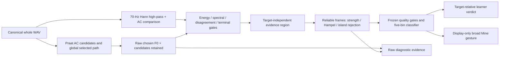

# Continuous F0 investigation and controlled tracker bake-off

**Decision: KEEP CURRENT TRACKER. No production source, classifier, learner mapping, target template or UI was changed by this investigation. Extra High is not justified now. Pronunciation acoustics are ready for a reviewed development checkpoint, with the documented uncertainty below. No commit was made.**

The fresh 马 is continuous, acoustically active speech with intermittent certainty about its periodicity. Its gaps are a mixture of weak/competing periodic evidence and partially recoverable candidate selection misses. They are **not missing audio and not good measured F0 discarded by Benma's later filters**. No tested alternative supplies a defensible continuous trajectory while protecting the corpus. “Pitch tracking was unstable” is technically honest here; it does not mean the recording was unintelligible or the intended tone was wrong.

Work remained on `pronunciation-calibration`, committed baseline `a8bdfab3d00365c00e1a10881e8999df63f2823c`. The baseline for every experiment is the existing validated **working-tree production code**, not that older commit. The interrupted investigation was resumed from its artifacts on September 26; the September 25 report directory and recording identities were retained. All 293 pre-existing dirty/untracked files were fingerprinted and remained byte-identical. Database reads used read-only transactions; audio copies and complete per-recording experimental tracks remain under `/tmp/benma-f0-corpus`. No paid provider calls, new dependencies, production evidence writes, full-suite reruns, performance project or feedback UI milestone occurred.

## Exact recordings and corpus

All four were recorded September 25, 2026. Matching uses persisted target, creation ordering, perception and current result, not approximate clock time alone. These are later than the four in the consistency report.

| Target | Attempt ID | Utterance ID | Created EDT | Perceived text | Current result |
|---|---|---|---|---|---|
| 妈 mā | `040a0e2d-59ed-49f7-8f88-4d0b6baad71e` | `3d10e9d3-1199-4c97-9d4d-d92e33b3cba2` | 16:23:53.118098 | 吗。 | 1-like / low / sustained_level_after_onset → Close |
| 马 mǎ | `fe40378c-36de-4138-bca1-5c9b25db4523` | `3e2ef0b3-c90f-4e9e-ab39-7d4eaca91a74` | 16:25:28.816951 | 妈。 | unclear / low / tracker_instability → Unclear |
| 骂 mà | `2945714c-8544-490d-b85c-3611dd47abb7` | `3f5ffcc7-4880-4fcd-8fc8-c620dfcfa1b2` | 16:26:05.912567 | 嘛 | 4-like / moderate / acoustic_shape_only → Good |
| 天 tiān | `51ee352c-d19d-430d-9881-4983242b298f` | `d92b8685-38d4-4846-a65f-69975d86100c` | 16:26:26.234287 | 天。 | unclear / low / ambiguous_shape → Unclear |

[Fresh diagnostics](fresh-diagnostics.json) preserve exact target IDs, UTC times, result projections, timing lineage, raw acoustic evidence and provider provenance. [Corpus inventory](corpus-inventory.json): **67 persisted acoustic recordings /116 syllable rows; 59 recordings /101 numerical spans; 95 timing-authorized and six timing-rejected spans.** Eight recordings have 15 rows without numerical timing, including three without syllable rows. Extraction ran on all 67 WAVs; downstream metrics use only the 95 authorized spans. No timing was fabricated for the other rows. This is a convenience human-audio corpus, not independently labeled F0 or pronunciation ground truth.

Current-code re-extraction and classification of persisted F0 agree on all **101 category/confidence/reason tuples**, and on all features for 100. The older low/subharmonic `618b19d5…` retains older acoustic filtering metadata: current re-extraction retains 39 rather than 44 frames, but both remain unclear/low_frequency_contamination. This pre-existing extractor-version difference is kept separate from the bake-off; every variant is compared with fresh extraction of the same WAV by current production. Production adoption impact is **zero**.

## Fresh 马: exact audio and gap evidence

Canonical mono PCM16, 16 kHz; duration **1.6254375 s**. Accepted alignment **[0.4700, 1.0400) s**; selected evidence is the **same interval**, with no boundary exclusions. Aligned RMS **0.0426345**, peak absolute PCM amplitude **0.18307495**. The recording-derived RMS gate is **0.00707416**.

All 30 selected voiced frames survive reliable filtering. Their four islands are:

- .5627–.5927 s: four frames, around 149–152 Hz.
- .6227–.7027 s: nine frames, around 86→72→79 Hz.
- .7527–.8727 s: 13 frames, around 111→129→123 Hz.
- .9327–.9627 s: four frames, around 64–66 Hz.

The retained core extends .5627–.9627 s, or .410 s including one hop. Coverage is **30/41 =73.17% of that core**, **52.63% of alignment**. The three gaps total **11 missing frame slots /110 ms**. Frame-slot support below means center ±5 ms; pitch estimation itself uses a wider analysis window. Endpoint intervals include the hop between accepted and missing centers and must not be mislabeled as entirely missing duration.

| Gap | Missing frame centers | Missing-slot interval | Missing duration | Accepted flanks | 40-ms RMS range | Actual gap-sample RMS / peak | Conclusion |
|---|---|---|---:|---|---|---|---|
| 1 | .6027, .6127 | [.5977,.6177) | 20 ms | .5927:151.730 Hz → .6227:86.140 Hz; 30-ms endpoint interval | .048245–.053451 | .050368 / .119385 | **Ambiguous/weak periodicity**, with partial CC support for the first frame |
| 2 | .7127–.7427 | [.7077,.7477) | 40 ms | .7027:78.827 Hz → .7527:111.185 Hz; 50-ms endpoint interval | .042953–.051224 | .044671 / .130005 | **Plausibly recoverable candidate-path miss in part**, with one weak frame and competing transition hypotheses |
| 3 | .8827–.9227 | [.8777,.9277) | 50 ms | .8727:123.135 Hz → .9327:63.947 Hz; 60-ms endpoint interval | .010491–.041365 | .021054 / .093781 | **Ambiguous fading periodicity and octave competition**, not a supported continuous branch |

All 11 missing centers have 40-ms RMS above the gate. To avoid energy-window overlap disguising silence, separate **10-ms RMS** was measured: gap 1 .048451–.052213; gap 2 .039565–.048834; gap 3 .006701–.034802. The last gap fades sharply, with its weakest 10-ms slice below the global gate even though the 40-ms window remains above it. Actual samples continue through all gaps; there is no absent-audio block or silent pause explaining the first two. The waveform visibly changes cycle structure and amplitude. Energy is evidence of acoustic activity, not proof of reliable fundamental frequency or physiological voicing.

The first two gaps lie in the sounding sonorant/tonal body; the third is in its fading offset. Gap 2 is especially clearly interior. We cannot assign exact /m/→/a/ or vowel boundaries: saved live Azure “phone” timing is **one whole `ma 3` interval**, not separate consonant/vowel timing. The same applies to `ma 1`, `ma 4` and `tian 1`. [Saved timing audit](phone-timing-audit.json). Thus none is explained by a *known* unvoiced consonant, but “every gap frame is definitely a voiced vowel” would exceed the evidence. No target-derived phone label enters extraction. For 天, the initial stop may legitimately remain unpitched; continuous alignment does not authorize voicing over it.

[Main six-panel plot](fresh-马-evidence.svg), [sample-level waveform zooms](ma-waveform-zooms.svg), [full numerical forensics](forensics.json), [every aligned frame and all AC candidates](ma-candidates.md). Plots distinguish raw path, alternate candidates, filtered reliable points, gaps, boundaries and diagnostic five-bin medians. No line through missing pitch is used as evidence. The medians are shown diagnostically even though this track fails quality.

### What candidates actually exist in each gap

Numbers below are Hz (strength). The complete candidate inventory, including weak competitors and adjacent accepted frames, is in [ma-candidates.md](ma-candidates.md); cross-method frequencies, strengths, usability and timestamps are in [forensics.json](forensics.json).

**Gap 1 — weak/ambiguous.** At .6027, candidates are **152.058 (.2955), 100.386 (.3171), 60.646 (.2998)**. At .6127, **99.174 (.2829), 86.952 (.3659)**. None reaches the frozen .45 reliable-strength gate. CC chooses 152.473/.5129 at .6027 but also leaves .6127 unvoiced. Independent NAC at .6000 gives 152.381/.3211, then no F0 at .6100. That is corroboration of one possible early continuation, with weak independent support; it is not a supported bridge through the transition from ~152 to ~86 Hz. The approximately octave-sized change persists under alternate tracking.

**Gap 2 — partial path-selection miss.** At .7127, **77.956 (.4550)** continues the preceding 78.827 Hz; competitors are 89.160 (.3412), 50.608 (.2554). At .7227, **89.425 (.4171)** and 64.720 (.2652) are below .45. At .7327, **100.015 (.5033)** competes with 89.658 (.2718). At .7427, **100.111 (.4815)** competes with 110.455 (.4023) and a near-half-frequency 52.644 (.4543).

CC selects **77.698/.5950, 89.478/.4329, 89.676/.4639, 100.048/.7117**. Its .7227 frame is still rejected by the unchanged .45 downstream gate, and .7327 chooses the ~90-Hz rather than AC's stronger ~100-Hz family. Independent NAC gives **77.670/.4429, 89.385/.3573, 98.765/.3597, 100.629/.4928**, on its .7100–.7400 grid. The final frame has the clearest three-way frequency corroboration; the earlier path is plausible but unevenly supported. Three of four AC frames have some candidate ≥.45, yet there is no all-supported four-frame path. This is a local recovery opportunity, not evidence that the entire syllable can safely become confident.

**Gap 3 — fading branch ambiguity.** At .8827, 110.174/.4703 is locally plausible but ~128.694/.4250 and ~62.518/.4442 compete. At .8927 and .9027, the strongest candidates are **64.367/.5507** and **65.022/.4750**; ~127-Hz alternatives are only .2556/.2709. At .9127 **all candidates are weak** (127.500/.4001, 66.585/.3883, 64.658/.3876). At .9227 the preferred local family switches back to **124.562/.4748**, with 63.700/.4361 competing. After the gap, .9327 itself has near-equal **63.947/.5117 versus 126.646/.5206**. A stronger candidate does not establish the correct octave.

CC supports 109.712/.5704 at .8827, then leaves .8927–.9227 unvoiced. Independent NAC selects approximately 110,64,missing,130,124 Hz; strengths .4168,.4057,.2495,.3580,.4007 are all below the unchanged reliable gate. Its later preference near 126–129 Hz contradicts Praat's ~64-Hz tail rather than resolving it. This is not a safe monotonic continuation, and doubling a branch would manufacture certainty.

**Quantification:** seven of 11 missing AC frames have *some* candidate ≥.45; four do not. Only three of four in gap 2 suggest a broadly plausible progression, with particularly good corroboration at .7427. In gap 3, four above-threshold candidates belong to competing families. Candidate existence alone therefore substantially overstates recoverable information. No tested global path recovers all three gaps defensibly.

## Exact current code path and configuration

Primary implementation: [acoustics.py](../../../services/api/src/benma_api/pronunciation/acoustics.py), [contours.py](../../../services/api/src/benma_api/pronunciation/contours.py), [evidence_region.py](../../../services/api/src/benma_api/pronunciation/evidence_region.py). Timing/provenance: `alignment.py`, `azure_alignment.py`, `timing.py`, `diagnostic.py`, `laboratory.py`, `perceived.py`; warmup/persistence: `warmup.py`, `AcousticAnalysisService`. Frontend `learnerVerdict.ts`, `learnerGestureContour.ts`, `normalizedDisplayContour.ts` remain consumers, not acoustic authorities. Prior architecture/final/consistency reports and the current diff were inspected before analysis edits.

Parselmouth **0.4.7**, embedded Praat **6.1.38**, analyzer version **1.2.0-parselmouth-0.4.7-praat-6.1.38**. `Sound.to_pitch_ac` is raw autocorrelation, not modern filtered AC. Explicit parameters: **10-ms step; 50-Hz floor; 550-Hz ceiling; 15 maximum candidates; very_accurate=false; silence=.03; voicing=.45; octave=.01; octave-jump=.5; voiced/unvoiced=.14**. Current settings and research settings are saved in [experiment-provenance.json](experiment-provenance.json).

Praat already performs global sequence selection; adding Viterbi is not inherently a new capability. Its selected path balances candidate periodicity, intensity and transitions. An unvoiced decision can coexist with a voiced candidate above .45. See the [version-matched Praat path-finder source](https://raw.githubusercontent.com/praat/praat/v6.1.38/fon/Pitch.cpp) and [Pitch candidate model](https://www.fon.hum.uva.nl/praat/manual/Pitch.html).

Production consumes the chosen path for measured F0 **and retains positive per-frame candidates up to the ceiling**. It does not persist the explicit zero-frequency state or frame intensity in that candidate list; both remain accessible by re-extracting the same WAV. No candidate-count scarcity motivates increasing 15 in this case. Current storage supports investigation without changing the extractor interface.

Post-processing is unchanged:

- Energy: 40-ms RMS sampled every 10 ms; gate `max(.003, min(3×p10_RMS, peak_RMS×.15))`. `tracker_f0_hz` preserves chosen pitch even when energy-gated `f0_hz` is missing.
- A 70-Hz Hann high-pass comparison, transition width 20 Hz, uses the same AC configuration. This is another view of the same algorithm, **not an independent estimator**. A 100-ms Hann spectrum measures 40–80-Hz energy as a fraction of 40–4000 Hz. Contamination if selected F0<80 Hz with fraction>.7, or raw/high-pass disagreement>6 st.
- The pre-existing bounded terminal rule can reject a short fading near-half-frequency branch with specified weak-alternative/energy/support conditions. It never doubles or substitutes F0; original candidates survive.
- Reliable filtering rejects quality-unusable frames or strength<.45; isolates brief >6-st islands bracketed by agreeing pitch and local Hampel outliers. Median-of-three smoothing stays within retained segments. Missing frames always split segments; >45-ms timestamp separation also splits them. No missing-frame interpolation.
- Evidence selection may exclude narrowly supported weak boundaries; it excludes none in fresh 马. The frozen classifier independently checks raw jumps, contamination, coverage, fragmentation and broad shape; display geometry cannot change it.

For **all 11 fresh 马 gap frames**, `tracker_f0_hz=None`, selected strength=0, energy is above the 40-ms gate, contamination=false. Thus the exact cause is **Praat selected the unvoiced candidate**. All 30 raw voiced frames remain reliable: **zero** energy, strength, Hampel/island, contamination or terminal-rule rejections create these three gaps. The current generic `selection_reason='praat_selected'` does not distinguish voiced from unvoiced; the developer audit adds `stage_decision='praat_selected_unvoiced'` without changing production fields.

The classifier's final veto is **tracker_instability**, with two large raw retained jumps, maximum **11.3435 st**, and all three gap endpoint changes flagged discontinuous. Robust bins are `[3.8321,−8.0594,.0098,1.2690,−10.4396]` st, reflecting inconsistent branches. The >6-st check counts neighboring voiced samples separated by up to .12 s, so gaps do not conceal their endpoint jumps. The existing isolated-glitch exception cannot apply because no implicated voiced observations were removed.

Missing evidence, rejected evidence, and display-bridged gaps remain distinct. These three primary gaps are missing selected evidence; CC experiments additionally produce rejected weak/contaminated evidence. Existing certified display bridging remains display-only and does not apply to this unstable recording.

## Experimental methods and safeguards

[bakeoff.py](bakeoff.py) evaluates whole recordings; no target, pinyin, classifier outcome or expected gesture is passed into any extractor. The research adapter substitutes only the two pitch-generation calls in the current production analyzer body; energy, spectral, terminal and downstream classification logic remain unchanged. An identity substitution is asserted exactly equal on **all 67 recordings**. Original production tracks and variant tracks are separate, preserving provenance. Candidate selection chooses actual Praat candidate objects, never calculated in-between frequencies.

1. **production:** exact current extraction and filtering.
2. **dp_balanced:** same AC candidate lattice; unvoiced always possible; candidate strength must be ≥.45. Voiced local score is strength−.45−.01×log2(550/F0); UV score uses the existing intensity/silence relationship relative to that .45 baseline. Transition cost is .03 per semitone plus .015×max(0,jump−2)², plus .25 for 10–14-st transitions; voiced/UV transition .14. Target-independent whole-recording Viterbi.
3. **dp_continuity:** same objective, voiced/UV cost **.30**. This is a structured comparison of persistence pressure, not a broad parameter search. It still permits UV and never lowers .45.
4. **cc:** raw cross-correlation, equivalent parameters, applied to primary and high-pass comparison. Different analysis windows/candidates are part of this method's behavior; it is not merely another path over the AC lattice. [Praat CC documentation](https://fon.hum.uva.nl/praat/manual/Sound__To_Pitch__cc____.html).
5. **legacy_nac:** Benma's existing independent Python normalized-autocorrelation estimator, 50–550 Hz, 40-ms Hamming frames, 10-ms hop, its original extraction threshold .32. Its own samples/estimates are independent of Praat, but it belongs to the same broad correlation family; this is not a pYIN/neural accuracy comparison. For downstream auditing, the frozen .45 reliable gate still applies and recording RMS/spectral/high-pass checks are attached from the nearest baseline frame within 5.1 ms, without interpolating F0. Original witness output is saved separately. **This asymmetric diagnostic adapter and uncalibrated cross-estimator strengths limit interpretation of its label counts.** No package was installed.
6. **fallback_cc, optional offline routing:** choose CC for a whole recording only when production has ≥2 internal gaps, each ≤80 ms and energetic at all missing centers. The trigger uses no target, timing or classifier result. It routes **19/67** recordings. This tests bounded second-pass routing, not pointwise fusion, and is not deployed.

Both new DP objectives are first-order: UV does not retain a hidden octave hypothesis through a long ambiguous gap. They also do not explicitly represent posterior uncertainty between two strong branches. Smoothness can select a persistently wrong subharmonic. The experiments therefore establish the behavior of these concrete objectives, not that every possible global model is ineffective. No additional Tone-3/Tone-4 rules, blind jump-cost sweep or repeat Gaussian experiment was added.

A development check corrected the research DP's silence-score scaling to match the intended Praat relationship. The pending corrected corpus run finished during the interruption. This report uses its completed outputs; continuation reused them rather than restarting extraction. Fresh forensic inputs were checked against final tracks and remained identical.

## Corpus results and interpretation

All below use **95 authorized spans**. “Sufficient” means passing existing acoustic quality gates, including supported exceptions; it includes `ambiguous_shape`, which has usable F0 but no supported category. “Severely fragmented” is a diagnostic count: ≥2 internal gaps or >80-ms missing run. Jumps are >6 st between voiced observations at most .12 s apart; octave events in this table are 10–14 st. The unchanged classifier's wider 9–15-st diagnostic is also saved.

| Method | Sufficient | Severe fragmentation / unstable reason | Gaps / missing seconds | Median voiced / core coverage | Large jumps / octave events | Category / tuple changes | Recording median / p95 ms |
|---|---:|---:|---:|---:|---:|---:|---:|
| Current | 63 | 10 /12 | 37 /1.26 | .589 /1.000 | 21 /6 | 0 /0 | 25.93 /77.56 |
| Balanced DP | 64 | 10 /12 | 35 /1.03 | .571 /1.000 | 22 /6 | 1 /2 | 43.34 /134.40 |
| Strong continuity DP | 63 | 4 /12 | 26 /.82 | .569 /1.000 | 19 /5 | 2 /3 | 43.92 /130.57 |
| CC | 56 | 12 /14 | 42 /1.12 | .590 /1.000 | 25 /7 | 20 /31 | 28.70 /82.41 |
| Independent NAC | 27 | 28 /56 | 116 /2.77 | .587 /1.000 | 224 /77 | 32 /58 | 535.74 /1705.36 |
| Bounded CC routing | 63 | 10 /11 | 34 /.95 | .590 /1.000 | 21 /6 | 6 /9 | 30.33 /120.72 estimated |

[Full metrics and distributions](metrics.md), [CSV](metrics.csv), [summary JSON](summary.json), [all spans/methods/features/timings](comparison.json), [actual TypeScript learner verdicts](learner-verdicts.json).

**Coverage must use stable denominators.** Shortening a retained core can improve its coverage without recovering anything. Fixed-production-core p10 coverage is **.797 current, .794 balanced, .769 strong-continuity, .749 CC, .676 NAC, .806 fallback**. Strong-continuity discards fresh 马's final four-frame island: core coverage rises .732→.813, while retained frames fall **30→26** and alignment coverage **.526→.456**. CC leaves 29 reliable frames and shortens the core too; its .906 core coverage is not recovery of a fully observed original core. Median core coverage=1 across methods mainly reflects the many already-continuous spans and is not a useful winner criterion alone.

**Balanced DP:** fresh 马 is exactly unchanged. The two changed tuples occur elsewhere: `02701fde-5dae-49d5-8c61-0d0ea21b8537` gains three actual terminal candidates at 106.806/.4897, 101.821/.4546, 99.616/.5480 Hz, promoting an already falling low-confidence result to moderate; `1120cb8a-4b88-4cac-9ba3-7229b65e2c6a` gains one 140.525/.4914 frame, changing insufficient_voicing to moderate 4-like. Both are understandable candidate recoveries, but neither establishes better accuracy, and corpus median coverage falls with no reduction in severely fragmented or unstable spans. A roughly 67% median extraction increase buys no recovery in the main failure case. **Global candidate-path replacement does not pass the gate.**

**Strong-continuity regression:** accepted Tone-1 attempt **`2fc0e7cd-87d2-4c62-8b26-7591b5ac5707`**, utterance **`b1970ccc-2d97-409c-a2e3-c1f4a894f4b4`**, changes **1-like /low /sustained_level_after_onset → unclear /low /low_frequency_contamination**. Increased persistence selects a ~55–66-Hz branch where production follows ~110–135 Hz; the high-pass comparison keeps the higher family. Contaminated raw frames increase 0→51 and reliable frames **49→0**. This is a concrete wrong-branch/control regression, not a Tone-1 threshold problem. It cannot be justified by fewer gaps elsewhere.

**CC is mixed, not production-ready.** It obtains five accepted candidate observations at previously missing fresh 马 centers (.6027,.7127,.7327,.7427,.8827), but introduces other losses/rejections, including .7227 below .45 and terminal raw/high-pass octave disagreement. Fresh 马 remains tracker_instability, maximum raw jump **9.8868 st**. Different windows/candidate preferences change onset, offset, voicing and octave decisions; some labels cross unchanged shape thresholds even without instability. Fresh 天 is an example: net fall −1.8857→−2.2174 st changes unclear→4-like. That is sensitivity to measured evidence near the −2-st boundary, not evidence that the intended Tone 1 was correctly recovered.

CC changes exactly **20 categories: ten accepted→unclear, eight unclear→category, two category switches**; another 11 confidence/reason-only changes produce **31 changed tuples**, with **19 confidence changes**. It reduces sufficient-quality spans 63→56, adds gaps 37→42 and jumps 21→25, breaks the prior shallow Tone 3 and certified short-gap Tone 4, and loses the accepted Tone-1 control above. The eight promotions are not automatically corrective. This is too much unvalidated churn to adopt. Praat's own [pitch FAQ](https://fon.hum.uva.nl/praat/manual/FAQ__Pitch_analysis.html) describes the tradeoff between recovering rapidly changing/irregular pitch with CC and assigning voicing where one would prefer uncertainty; these corpus measurements, rather than that general guidance, drive the decision.

**Independent NAC is a diagnostic witness.** On strong production frames it provides matching usable estimates for 1,840/1,861 observations, with **1,838 within 1 st**. That corroborates strong local periodicity but does not certify ambiguous gaps. In gap 2 its final ~100-Hz candidate supports a local miss; elsewhere its low strengths and changing octave preferences reinforce uncertainty. Its controlled downstream projection loses 29 accepted categories and promotes three unclear ones, while runtime is ~20× production. Strengths are not calibrated between estimators, and the comparison adapter is asymmetric; neither the apparent agreement nor the large regression count establishes F0 ground truth. It provides no evidence for automatic fusion or an extra quality veto now.

**Fallback:** routing narrows but does not solve the tradeoff: six category changes, including three accepted→unclear and one category switch; sufficient-quality count is unchanged. It leaves fresh 马 unstable and promotes the historically fragmented `9957925d…` to a low-confidence shallow valley without independent truth validating the promotion. Pointwise recovery requiring neighbor continuity and an independent high-strength witness would be more conservative than this routed replacement, but here it has at most a few compelling individual frames and no demonstrated improvement in the learner decision. Its complexity and uncertainty calibration are not justified for deployment by this corpus.

## Complete change inventory and protected controls

**Every changed category, confidence or reason** for every serious alternative, including NAC and fallback, appears in [classification-changes.md](classification-changes.md) and [classification-changes.json](classification-changes.json). Each row includes attempt/utterance, target, perception, syllable, before/after category/confidence/reason, evidence counts and per-frame changes. [Change audit summary](change-audit-summary.json) separates promotions needing review, category switches needing review, losses of previously accepted results, and confidence/reason-only changes. No correctness label was derived from a target character or expected tone.

[Protected-control table](controls.md) lists exact IDs and every method's output. Accepted representative Tones 1–4 and neutral all retain their categories under both DP variants, **except the separately included accepted Tone-1 regression above**. Neither DP promotes the established low-frequency or octave-unstability controls. Both preserve the previous certified short-gap Tone 4 and shallow Tone 3. CC preserves the four clean representative categories and neutral, but loses the accepted Tone-1 regression control, short-gap Tone 4 and shallow Tone 3; the old octave/subharmonic failures remain uncertain. Independent NAC loses the representative accepted Tone 3 and Tone 4 and changes the low/subharmonic rejection reason to tracker instability. Neutral target feedback remains context-dependent; an observed 3-like category is not a neutral-tone error.

The four new controls further separate tracking from classification:

- **妈:** duration 1.834375 s, alignment .59–1.26 s, 42 continuous retained frames. Stable-core medians `[.0122,.2610,.1256,−.1181,−.1597]` sustain low-confidence level evidence. Both DPs are unchanged; CC keeps Close with 41 frames; NAC becomes unstable. No promotion to Good was forced. [Plot](fresh-妈-evidence.svg).
- **马:** all alternatives remain unclear/tracker_instability. Balanced DP changes no retained point; stronger persistence drops four tail frames; CC recovers some frames but changes evidence elsewhere; NAC remains fragmented/unstable. This is a tracking-quality issue, not a demand that the measured trajectory be Tone 3.
- **骂:** duration 1.4164375 s, alignment .53–1.02 s; 21 continuous frames, medians `[1.3685,.7764,.1110,−1.2095,−.9650]`, net −2.3335 st. Both DPs and CC preserve moderate 4-like /Good. NAC becomes unstable. [Plot](fresh-骂-evidence.svg).
- **天:** duration 1.37 s, alignment .50–1.02 s; 23 continuous frames at .67–.89 s. Medians `[1.0736,.4322,.0043,−.1728,−.8121]`, net/range −1.8857/1.8857 st: outside level limits but short of the unchanged falling threshold. Both DPs and NAC remain ambiguous; CC crosses into moderate 4-like, yielding target-relative Different. Its absence of internal gaps means it should not be “fixed” by assuming the target was correct. The bounded fallback leaves it unchanged. [Plot](fresh-天-evidence.svg).

## Runtime, invariants, validation and checkpoint

Runtime is measured local extraction, not API/provider latency or a production SLA. Three rotated repetitions per Praat method, one per NAC recording, after import warmup. On **49 recordings with exactly one numerical span**, median/p95 extraction is **24.20/38.39 ms current; 40.12/62.79 balanced; 39.36/62.85 strong-continuity; 26.39/41.28 CC; 484.22/745.03 NAC**. Across all timed recordings, amortized per-span times are in [metrics.md](metrics.md). Cropping syllables was avoided because that changes global-path context. NAC timings include its estimator and quality adapter but reuse precomputed production comparison fields; a standalone replacement would need that additional cost. Fallback times are estimated sums of measured primary+CC, without trigger overhead. No memory profiler was run: research DP uses rolling O(K²) transitions and O(frames×K) backpointers, K≤15, with no model weights or new large dependency.

**Target independence: yes. Interpolation into grading: no.** Extraction takes only audio/configuration; DP takes candidates/intensity/configuration. Tests verify chosen values are actual original candidates, true no-candidate and weak onset regions remain missing, four supported shapes retain their supported branches, and changing target tags 1–4 on identical human evidence changes neither evidence region nor observed features. Raw inputs remain unchanged. Actual target-relative verdicts were calculated by the existing TypeScript function, not reimplemented in Python. Existing display bridging and classifier exceptions were not edited.

[Validation record](validation.md): 13 focused research tests pass; Python analysis lint/format and JS syntax pass; JSON/SVG/artifact consistency and totals pass; corrected final fresh traces match saved forensic inputs; all 67 identity-adapter checks pass; git diff whitespace and secret scan pass. Main and waveform-zoom SVGs were rendered with the already-installed SVG renderer and visually inspected. No production behavior changed, so the previous branch's full validation was not rerun or represented as a new full-suite result.

Files added by this pass are entirely under **`docs/calibration/2026-09-25-f0-tracking/`**: reproducible export/experiment/audit/forensic/report scripts and focused tests; fresh diagnostics/traces, corpus inventory/comparison, metrics, complete changes/verdicts, SVGs, provenance and validation files. [File manifest](files.txt), [final git status --short](final-status.txt), [final git diff --stat](final-diff-stat.txt), [initial status](initial-status.txt), [initial stat](initial-diff-stat.txt), [pre-existing hashes](preexisting-sha256.json). Git diff --stat still describes the prior 20 tracked modified files, **1,607 insertions /147 deletions**, because this pass adds only untracked analysis artifacts. All earlier source/UI/tests/reports remain intact.

**Production gate:** concrete mechanisms and real partial candidate support exist, but no method demonstrates material reliable-continuity improvement, protected controls, small justified churn and worthwhile cost together. Balanced DP lacks meaningful recovery; stronger DP fails a control; CC and NAC trade failure modes; bounded routing remains unvalidated. Adopt none.

**KEEP CURRENT TRACKER. Extra High is not justified now:** the corpus does not show a clearly superior architecture waiting for integration. A future investigation would first need independently reviewed cycle/F0 and voicing evidence across multiple speakers, especially irregular phonation and octave competition, before choosing uncertainty-aware candidate fusion or a new engine. Do not start that redesign from this result. The known limitation is that intelligible continuous speech can contain ambiguous periodic structure that Benma conservatively leaves unjudged. The current branch is ready for a **reviewed development checkpoint**, not a claim of population-calibrated pronunciation accuracy. No commit, push or UI milestone was started.
