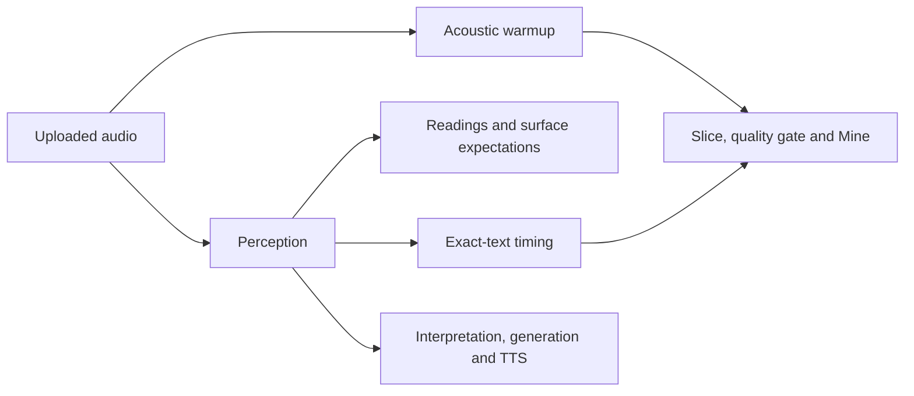

# Perception, alignment and pitch — final evidence, 2026-09-18

Checkpoint update: [real-human Chromium acceptance was performed](../testing/pronunciation-manual-acceptance.md#checkpoint-acceptance--2026-09-18).
Correct perception, surface expectations, per-syllable learner contours and conservative
**Unclear** results are accepted for this checkpoint. Larger-corpus quality-gate calibration,
mini-contour/Expected-vs-Mine UX polish, physical Stop → chart latency and physical iPhone
acceptance remain follow-ups. No pronunciation thresholds changed during checkpoint finalization.
The report and workspace snapshots below record the earlier implementation pass; its pending
acceptance/commit statements are historical and superseded by this update.

Work continued in the existing dirty `/home/jacob/benma` tree. No reset, revert, checkout,
stash, discard, commit, or new milestone. HEAD remains
`b3ab72c20786d370a9e754424ba7187f5658a7ce`. The appendix includes the whole milestone's
tracked diff statistics and status; those include changes that predated this pass.

The implementation is ready for real-human acceptance. That acceptance, including a physical
iPhone, is still outstanding. The saved real 你好 gives **你 2-like / 好 unclear**, with an
explicit 15.3104-semitone tracker-instability reason. No gate was weakened to force 好 into
an expected category. Automated rendering checks are not human-speech validation.

Detailed sanitized measurements: [JSON evidence](../benchmark/perception-alignment-pitch-2026-09-18.json).
No raw recording or complete private provider response was added to the repository.

## Transcription and truth boundaries

**`gpt-4o-transcribe` remains the default.** Production sends `language=zh`, JSON output,
log probabilities, and the fixed server-owned `mandarin-verbatim-v1` prompt. It asks for
Simplified Chinese transcription of only spoken Mandarin, preserving unusual wording,
hesitations, repetitions and incomplete fragments; no translation, grammatical repair,
completion or correction of pronunciation ambiguity. There are no semantic examples,
conversation turns, intended targets, user corrections or assistant history in that request.
The public request rejects arbitrary prompt/context fields. The profile and exact form fields
are stored with perception provenance, including failed requests. Original provider payloads
and transcripts remain immutable.

Language metadata accepts either a declared `language` or `languages: [{code: ...}]`; an
explicitly empty list stays empty, and absent detection stays absent. Log probabilities are
not timestamps. The adapter supports the tested alternative's documented request shape, but
does not select that model by default. See the official
[OpenAI speech-to-text guide](https://developers.openai.com/api/docs/guides/speech-to-text).

The **completed five-recording, 15-call bakeoff was not repeated**:

| Audio case | Old language hint only | Fixed policy on gpt-4o-transcribe | Tested gpt-transcribe |
|---|---|---|---|
| 你好 | 你好 | 你好 | 你好。 |
| Short cross-script failure A | Neal zaigan shima | 那宰刚什么。 | 你好，在干什么？ |
| Short cross-script failure B | Neal Zaidanşma | 你要宰干什么 | 你好，在干什么？ |
| Longer sentence | 你好，今天我们聊聊周末吧。 | Same wording | Changed 周末 to 什么 |
| Incomplete phrase | 你好，今天我 | 你好，今天我 | 你好，呃，今天我。 |

Chinese-script output improved from 3/5 to 5/5 with the fixed policy, while the incomplete
utterance remained incomplete. Fixed-policy elapsed times were 1463, 1467, 1341, 1790 and
1255 ms respectively. These are single observations, not a latency distribution or an
independently annotated transcription-accuracy score. The alternative's more natural wording
on two clips is not proof of the learner's intent. Its changed wording on the longer clip
supports retaining the current model.

## Timing, provenance and configuration

Free-speech timing chooses exact persisted single-character ASR timing when truly present,
then the configured aligner for missing units. Azure receives only canonical audio and the
**exact persisted PerceptionRun transcript**, including its punctuation. It is asked where
the syllables of what Benma heard occur, not how correctly an intended phrase was pronounced.
The free-speech path never creates a PronunciationTarget or AssessmentRun, rewrites perception,
or uses `inferred_text` as its reference.

Azure's zh-CN SAPI `Phonemes` entries contain full labels such as `ni 2` and `hao 3` on the
validated recordings. The adapter maps these by exact word text, character position and
base pinyin, retaining provider offsets/durations. The label's tone digit is reference metadata,
not an observed Mine tone. A one-character word can use its exact word span; a multi-character
word needs matching full-syllable entries. There is no equal subdivision or fuzzy word search.
Punctuation is ignored for mapping, neutral `5` is supported, and unresolved portions stay
untimed. Sorted spans must be finite, positive, monotonic and within the recording. Long
silences do not reduce transcript-unit coverage.

The append-only PerceivedSpeechAnalysis stores source utterance/perception IDs, the exact
reference snapshot and hash, provider/version/config, whitelisted word/phone offsets, mapped
units, timing evidence ID, coverage, latency, status and error. Provider scoring fields are
discarded from alignment evidence. Public syllables include their timing source/evidence ID.
See [Azure's assessment response documentation](https://learn.microsoft.com/en-us/azure/ai-services/speech-service/how-to-pronunciation-assessment)
for the transport; this application deliberately uses only its timing fields in free speech.

Defaults are `acoustic_provider=praat`, `alignment_provider=auto`. Auto requests Azure only
when credentials exist **and** `azure_alignment_enabled=true`; explicit `azure` is also an
opt-in. `disabled` does not make timing calls. This machine's ignored local `.env` explicitly
selects Praat, auto and the Azure opt-in. The example file leaves the paid opt-in false.
Timeout is 12 seconds. Recordings over Azure's 30-second short-audio limit retain text/pitch
with timing unavailable. MFA and FunASR were not installed. Replay partitions remain labeled
synthetic and cannot produce real Mine classifications.

Final real-data validation reused the three saved live Azure responses, verified their audio
hashes and exact transcript snapshots, and persisted `transport=saved_live_response` with the
response hash and original provider latency. The new local remapping time is distinct from
the original HTTP latency. **New provider calls during both resumed portions: zero.** The
earlier complete pass made 15 transcription and 3 Azure timing calls.

## Real results

The final public API serialization was checked against the persisted source records.

| 你好。 syllable | Dictionary | Expected here | Azure span, seconds | Usable coverage | Mine |
|---|---:|---:|---|---:|---|
| 你 nǐ | 3 | 2 | 0.59–1.17 | 72.4% | 2-like |
| 好 hǎo | 3 | 3 | 1.18–1.71 | 69.8% | unclear: tracker instability |

Timing coverage is **2/2**. 你 has a robust rising change of 2.2561 semitones. 好 has a
15.3104-semitone jump between nearby tracker samples, above the 6-semitone instability gate.
It retains a derived contour and its original measurements; the system does not call it wrong,
correct, or Tone 3 merely because Tone 3 is expected.

For **你好，今天我们聊聊周末吧。**, all readings are resolved and real timing covers **11/11**:

| Syllable | Dictionary → surface | Azure span | Mine / limiting evidence |
|---|---|---|---|
| 你 nǐ | 3 → 2 | .77–1.22 | unclear; 46.7% voiced coverage, below 50% |
| 好 hǎo | 3 → 3 | 1.23–1.59 | 1-like |
| 今 jīn | 1 → 1 | 1.62–1.89 | unclear; ambiguous shallow fall (−1.6998 st) |
| 天 tiān | 1 → 1 | 1.90–2.27 | 1-like |
| 我 wǒ | 3 → 3 | 2.28–2.48 | 1-like |
| 们 men | 0 → 0 | 2.49–3.12 | 1-like acoustic shape |
| 聊 liáo | 2 → 2 | 3.28–3.91 | 4-like |
| 聊 liáo | 2 → 2 | 3.92–4.29 | 1-like |
| 周 zhōu | 1 → 1 | 4.30–4.44 | 1-like |
| 末 mò | 4 → 4 | 4.45–4.55 | unclear; 100 ms, below 120 ms minimum |
| 吧 ba | 0 → 0 | 4.56–4.94 | unclear; 36.8% voiced coverage |

These labels describe measured shapes, not target correctness. In particular, neutral lexical
tone does not justify a neutral Mine label. The response vocabulary permits `neutral-like`, but
this classifier does not claim to identify neutral tone from isolated F0 without sufficient
contextual/prosodic evidence. A neutral syllable can have a level, falling or unclear shape.

For **你好，今天我**, coverage is **5/5**, despite long pauses: .95–1.26, 1.27–1.72,
3.29–3.66, 3.67–4.28, 4.84–5.73 seconds. Readings are nǐ hǎo jīn tiān wǒ; dictionary
3,3,1,1,3 and surface 2,3,1,1,3. Mine is **1-like, 1-like, unclear, 1-like, unclear**.
今 fails with 15% contaminated voiced frames and a 14.2231-st jump; 我 has 100% filtered-track
disagreement among its raw voiced frames. Their reason is `low_frequency_contamination`.
The fragment is not completed semantically by transcription or pronunciation analysis.

## Pitch choice and quality limits

Praat/Parselmouth is the selected default, with the former autocorrelation implementation
retained as an explicit configuration fallback and comparison baseline. Provenance records
`praat_autocorrelation`, adapter 1.1.0, Parselmouth 0.4.7, embedded Praat 6.1.38 and every
parameter. Dependency/lockfile changes declare Parselmouth and its NumPy dependency.
An optional tracker failure yields unavailable acoustic evidence and does not block ASR or
Conversation. There is no silent fallback that changes algorithms without changing provenance.

| Clip | Existing autocorrelation runtime | Basic Praat runtime | Final full gated extraction | Adjacent octave-sized jumps, old → basic Praat |
|---|---:|---:|---:|---|
| 你好 | 509.7 ms | 1.7 ms | 46 ms | 6 → 1 |
| Longer sentence | 1664 ms | 3.5 ms | 72 ms | 1 → 0 |
| Noisy incomplete | 2578.5 ms | 4.0 ms | 109 ms | 7 → 3 |

The basic tracker numbers exclude application normalization and quality work. Jump counts are
9–15-st adjacent differences, an artifact proxy, not hand-labeled octave-error truth. On the
noisy clip basic Praat tracked 748 voiced frames with a 60.3-Hz median, including background
energy. The final energy gate retains 208 raw voiced frames; 143 also pass contamination checks.
This failure is why maturity or speed alone did not decide the implementation. Naive octave
unwrapping was rejected: one error propagated and locked another clip near 56.9 Hz.

The final gate uses a bounded recording-relative RMS floor, a 50–550-Hz tracker range,
periodicity/voicing support, 40–80-Hz spectral dominance, and disagreement with a second
70-Hz Hann-filtered tracking pass. A >6-st disagreement flags ambiguity; the second pass
**never replaces F0**. At syllable level, ≥15% contamination or >6-st nearby instability
prevents a label. Duration, at least eight display samples, ≥50% coverage, retained evidence,
fragmentation and jagged movement also gate classification. Broad shapes use five robust
bins after quality checks, independent of the expected category.

The original `tracker_f0_hz`, energy-gated `f0_hz`, periodicity, RMS, spectral/disagreement
metrics and gate flags remain stored. Display filtering is separate: isolated outliers and
brief supported octave islands can be dropped; no octave correction or interpolation occurs.
Some sustained ambiguous regions remain visible, particularly in 好 and whole-utterance
details. Their presence is not evidence for a confident tone label. The implementation does
not erase every unusual low valley to make a cleaner picture.

Focused waveform regressions cover level/rising/falling/dipping contours, pure 60-Hz hum,
55-Hz harmonic speech, a legitimate dip reaching about 57 Hz, and 300-Hz speech. The low
voices and dip pass; pure hum fails. These are conservative heuristics, not calibrated clinical
voice-quality or lexical-tone scores. More real speakers and creaky-voice examples remain
important for human acceptance. The offline calibration corpus still has 0/50 real pilot
recordings; categorical correctness remains disabled.

## Surface expectations, UI and concurrency

Dictionary tones stay immutable. A separate versioned rule layer supports simple third-tone
pairs (including 你好), 不 before fourth tone, and reviewed quantity uses of 一. Ordinals and
numbers preserve 一's citation tone; ambiguous grammatical/reduplication uses and longer
third-tone chains remain unset. Neutral tone stays 0 with no fixed expected contour. Target
Practice shares the conservative rules while retaining its explicit target-relative assessment.

The primary cards show Expected here and Mine. More detail shows dictionary categories and
the reason for unclear evidence. A separate read-only readings resource can populate cards
while timing runs; late previews cannot replace completed analysis. Non-Han perception stays
verbatim, with a compact unavailable state instead of empty cards. Mixed text retains grounded
Han cards and locally lists unresolved spans. The whole-utterance contour remains secondary.

Raw acoustic warmup begins before ASR in a bounded optional worker pool. It uses an owned
worker session. The PostgreSQL `FOR NO KEY UPDATE` lock on the utterance spans cache lookup,
computation and persistence, so warmup, direct acoustic requests and analyses reuse one run
for the same algorithm/version/parameters. Duplicate perceived analyses serialize on their
source perception and reuse the configuration hash. These locks permit ASR and meaning FK
inserts. The race test deliberately holds acoustics while the real PerceptionService with an
unpaid provider completes and persists, and meaning proceeds. Cross-request exclusion relies
on PostgreSQL; SQLite browser fixtures are not evidence for PostgreSQL locking behavior.



## Latency and validation

All numbers below distinguish prior live providers from local reuse. No new transcription or
alignment HTTP requests were made to manufacture a fresh end-to-end latency result.

| Stage, milliseconds | 你好 | Longer | Incomplete |
|---|---:|---:|---:|
| Original persisted ASR | 1629 | 2211 | 1710 |
| Original live Azure timing | 892 | 1119 | 1503 |
| Full gated acoustic extraction | 46 | 72 | 109 |
| Reading resolution, final local pass | 3.550 | .467 | .227 |
| Surface resolution | .077 | 1.062 | .031 |
| Display filter | .962 | 1.918 | 1.284 |
| Syllable slicing | .036 | .141 | .052 |
| Quality gate | .150 | .477 | .334 |
| Observed classification | .048 | .188 | .075 |
| Acoustic persistence flush, first extraction | 4.687 | 5.007 | 6.704 |
| Analysis with fresh acoustics + saved Azure response | 62 | 83 | 119 |
| Actual local request wall, same first extraction | 128.034 | 91.378 | 126.312 |
| Final versioned analysis reusing acoustics | 14 | 9 | 7 |
| Actual local wall, reusing acoustics | 85.280 | 19.778 | 13.991 |

Final saved-response mapping took about 1 ms. Reusing acoustic evidence makes its historical
`pitch_latency_ms` different from current request wall time. Initialization, DB lookup and
commit overhead explain why wall time exceeds analysis timing. Commit duration and total
wall are now emitted through the structured logger; preexisting real rows did not persist
commit timing separately. The current diagnostic exposes the stored stages without inventing
that missing historical metric.

Using separately measured original provider stages, the serial ASR + acoustic + Azure sums
are **2567 / 3402 / 3322 ms**. With acoustic/ASR overlap, the modeled provider critical path
is `max(acoustic, ASR + Azure)`: **2521 / 3330 / 3213 ms**, plus readings, contour and storage
overhead. These sums are estimates assembled from separate calls, not new live wall-clock runs.

The final Chromium **fake-microphone, unpaid-provider** run measured **378.7 ms** from automated
Stop click to analysis UI availability with the actual concurrent application pipeline. This
is fixture timing, **not physical Stop→chart latency**. Its ungated assistant response branch
took 10.7 ms and fixture TTS 52.4 ms independently; these are not estimates of live model/TTS
latency. The other held response was intentionally delayed for layout testing. The JSON
contains the complete branch timings and measured server stages.

Automated checks at completion:

- Full API suite: **290 passed in 28.31 seconds**, including two isolated PostgreSQL races.
- Focused transcription, Azure mapping, real lineage, quality, low-voice/dip, surface and
  ownership suites passed. No paid test providers were used.
- Ruff passed; strict mypy passed on 71 source files.
- PostgreSQL Alembic parity: no new upgrade operations. Existing dirty migration 0010 remains;
  this pass adds no migration because provenance and derived fields fit the existing JSON data.
- OpenAPI regenerated and byte-identical on a second run.
- Full native/web Jest: **185 tests, 20 suites passed**; TypeScript and ESLint passed.
- Expo **web, Android and iOS** exports passed. Online dependency check passed after four
  SDK-57-compatible patch updates: Expo, Metro runtime, Constants and Router. No unrelated
  dependency/security upgrade was performed.
- Offline benchmark: **96 tests passed**, Ruff/mypy/corpus/fixture reports passed. Its real
  calibration readiness remains honestly NOT READY at 0/50.
- `git diff --check` and secret scan passed; final report-only check recorded below.

Chromium 153 fixture integration completed with no page errors: authentication, Conversation,
free and target Practice, readings, surface shapes, unclear states, whole-utterance detail,
assistant independence, learner/assistant/reference playback, autoplay recovery, playback→record
interruption and cleanup. All four uploads passed. Object URLs and tracks were released at
sign-out. Pronunciation stayed 270 px high before/after reply and analysis on desktop and
390-px narrow layout, with the reply position unchanged. Component regressions additionally
verify measured Mine labels, lexical/surface separation, late previews and compact non-Han UI.

A second narrow Chromium check rendered the exact saved real 你好 API data through mocked
responses, explicitly marked as a UI fixture: Expected 2/3, Mine 2-like/unclear, and the
tracker-instability detail all rendered. It then rendered a Latin transcript verbatim with a
**93-px** pronunciation section and no page errors. This verifies presentation, not a new
recording or live-provider result.

## Diagnostics, files and remaining acceptance

Run from `services/api`:

```sh
uv run python -m benma_api.pronunciation.diagnostic
uv run python -m benma_api.pronunciation.diagnostic --utterance-id UUID
```

This is read-only and makes no provider calls. It reports duration, exact perception, Han
ratio, provider/model, readings, dictionary/surface tones, timing source/spans/coverage,
tracker/version, quality metrics, Mine and stored latencies. It prints no keys, authorization
headers, protected URLs, storage paths or complete provider payloads. The specific real 你好
command was executed successfully.

Principal files changed in this pass: OpenAI/Azure speech adapters and perception provenance;
config, acoustics, Azure alignment, perceived analysis, readings, surface/target rules,
contours, warmup, diagnostic, routes, logging and schemas; mobile API contracts, speech
workflow and feedback components; affected API/UI/race tests and browser harness; API Python
dependency/lock files, Expo package/lock files, READMEs and this report. Small formatter-only
changes to pronunciation capabilities/interpretation are included. The ignored local `.env`
configuration change is intentionally absent from Git. The appendix lists every current dirty
path rather than suggesting that all were created in this pass.

Use [the short manual checklist](../testing/pronunciation-manual-acceptance.md): run `benma-api`
and `benma-mobile`; with a **real Chromium microphone**, say 你好, the longer sentence, the
incomplete phrase, and one deliberately changed tone. Check script, readings, dictionary vs
surface, real timing, defensible Mine/unclear reasons, contour, Play mine and independent
assistant text/audio. Then test free and target Practice and **one physical iPhone** Conversation,
AssistantSpeech autoplay/replay, ReferenceSpeech and playback→recording interruption.

There is no known implementation blocker to starting those checks. Remaining acceptance work
is real-human microphone/speaker behavior, physical iPhone behavior, and broader real voice
quality—especially the saved 好 instability. A clean automated fixture run does not certify
these. Milestone commit remains pending that acceptance and review of the whole intentional
dirty tree. No commit was made, and no next milestone was started.

## Final workspace appendix

Final Ruff/mypy, `git diff --check` and secret scan passed. Temporary fixture API and static
web servers were stopped. No user development service was stopped. No commit was made.

`git diff --stat` below covers tracked changes only; it excludes the untracked implementations
and reports listed by status and the expanded untracked list. These snapshots include all
preexisting milestone changes.

### Full git diff --stat

```text
 Makefile                                           |    1 +
 README.md                                          |   31 +-
 apps/mobile/README.md                              |  142 +-
 apps/mobile/expo-env.d.ts                          |    6 +-
 apps/mobile/package-lock.json                      | 2008 +++++++------
 apps/mobile/package.json                           |   58 +-
 apps/mobile/src/__tests__/apiClient.test.ts        |  249 +-
 apps/mobile/src/__tests__/pitchPlot.test.ts        |    9 +-
 apps/mobile/src/api/client.ts                      |  173 +-
 apps/mobile/src/api/openapi.generated.ts           |  117 +
 apps/mobile/src/api/openapi.json                   | 2959 ++++++++++++++------
 apps/mobile/src/api/types.ts                       |   11 +
 apps/mobile/src/app/_layout.tsx                    |   18 +-
 apps/mobile/src/app/history.tsx                    |    6 -
 apps/mobile/src/app/index.tsx                      |   23 +-
 apps/mobile/src/app/pronunciation.tsx              |    5 -
 apps/mobile/src/audio/PlaybackButton.tsx           |   64 +-
 apps/mobile/src/audio/useAudioCapture.ts           |   97 +-
 apps/mobile/src/auth/AuthProvider.tsx              |   13 +-
 apps/mobile/src/components/PitchPlot.tsx           |  218 +-
 apps/mobile/src/components/Ui.tsx                  |   19 +-
 .../pronunciation-calibration.manifest.json        |    4 +-
 docs/testing/physical-device.md                    |  163 +-
 services/api/.env.example                          |   15 +-
 services/api/README.md                             |   88 +-
 services/api/pyproject.toml                        |    6 +-
 services/api/src/benma_api/api/blocking.py         |   10 +
 services/api/src/benma_api/api/routes.py           |  271 +-
 services/api/src/benma_api/app.py                  |    9 +
 services/api/src/benma_api/audio/service.py        |    5 +-
 services/api/src/benma_api/config.py               |   48 +-
 .../benma_api/contextual_interpretation/openai.py  |   37 +-
 services/api/src/benma_api/conversation/service.py |   42 +-
 services/api/src/benma_api/db/models.py            |   34 +
 services/api/src/benma_api/logging.py              |    6 +
 services/api/src/benma_api/perception/service.py   |    9 +-
 .../api/src/benma_api/pronunciation/acoustics.py   |  426 ++-
 .../api/src/benma_api/pronunciation/alignment.py   |  185 +-
 .../src/benma_api/pronunciation/capabilities.py    |    4 +-
 .../src/benma_api/pronunciation/interpretation.py  |    9 +-
 .../api/src/benma_api/pronunciation/laboratory.py  |  215 +-
 .../api/src/benma_api/pronunciation/service.py     |  143 +-
 .../api/src/benma_api/pronunciation/targets.py     |  112 +-
 services/api/src/benma_api/schemas.py              |  127 +
 services/api/src/benma_api/speech/contracts.py     |    2 +
 .../api/src/benma_api/speech/providers/azure.py    |   78 +-
 .../api/src/benma_api/speech/providers/openai.py   |   78 +-
 services/api/tests/test_assistant_generation.py    |   39 +-
 .../api/tests/test_assistant_speech_provider.py    |   28 +-
 services/api/tests/test_audio_utterances.py        |   24 +-
 services/api/tests/test_auth_config.py             |   16 +
 services/api/tests/test_blocking.py                |   16 +
 .../test_contextual_interpretation_provider.py     |   40 +
 services/api/tests/test_migrations.py              |    1 +
 services/api/tests/test_perception_truth.py        |   18 +-
 .../api/tests/test_pronunciation_laboratory.py     |   85 +-
 services/api/uv.lock                               |   39 +
 57 files changed, 6249 insertions(+), 2410 deletions(-)
```

### git status --short

```text
 M Makefile
 M README.md
 M apps/mobile/README.md
 M apps/mobile/expo-env.d.ts
 M apps/mobile/package-lock.json
 M apps/mobile/package.json
 M apps/mobile/src/__tests__/apiClient.test.ts
 M apps/mobile/src/__tests__/pitchPlot.test.ts
 M apps/mobile/src/api/client.ts
 M apps/mobile/src/api/openapi.generated.ts
 M apps/mobile/src/api/openapi.json
 M apps/mobile/src/api/types.ts
 M apps/mobile/src/app/_layout.tsx
 M apps/mobile/src/app/history.tsx
 M apps/mobile/src/app/index.tsx
 M apps/mobile/src/app/pronunciation.tsx
 M apps/mobile/src/audio/PlaybackButton.tsx
 M apps/mobile/src/audio/useAudioCapture.ts
 M apps/mobile/src/auth/AuthProvider.tsx
 M apps/mobile/src/components/PitchPlot.tsx
 M apps/mobile/src/components/Ui.tsx
 M benchmark/reports/outputs/pronunciation-calibration.manifest.json
 M docs/testing/physical-device.md
 M services/api/.env.example
 M services/api/README.md
 M services/api/pyproject.toml
 M services/api/src/benma_api/api/blocking.py
 M services/api/src/benma_api/api/routes.py
 M services/api/src/benma_api/app.py
 M services/api/src/benma_api/audio/service.py
 M services/api/src/benma_api/config.py
 M services/api/src/benma_api/contextual_interpretation/openai.py
 M services/api/src/benma_api/conversation/service.py
 M services/api/src/benma_api/db/models.py
 M services/api/src/benma_api/logging.py
 M services/api/src/benma_api/perception/service.py
 M services/api/src/benma_api/pronunciation/acoustics.py
 M services/api/src/benma_api/pronunciation/alignment.py
 M services/api/src/benma_api/pronunciation/capabilities.py
 M services/api/src/benma_api/pronunciation/interpretation.py
 M services/api/src/benma_api/pronunciation/laboratory.py
 M services/api/src/benma_api/pronunciation/service.py
 M services/api/src/benma_api/pronunciation/targets.py
 M services/api/src/benma_api/schemas.py
 M services/api/src/benma_api/speech/contracts.py
 M services/api/src/benma_api/speech/providers/azure.py
 M services/api/src/benma_api/speech/providers/openai.py
 M services/api/tests/test_assistant_generation.py
 M services/api/tests/test_assistant_speech_provider.py
 M services/api/tests/test_audio_utterances.py
 M services/api/tests/test_auth_config.py
 M services/api/tests/test_blocking.py
 M services/api/tests/test_contextual_interpretation_provider.py
 M services/api/tests/test_migrations.py
 M services/api/tests/test_perception_truth.py
 M services/api/tests/test_pronunciation_laboratory.py
 M services/api/uv.lock
?? apps/mobile/.gitignore
?? apps/mobile/scripts/
?? apps/mobile/src/__tests__/assistantPlayback.local-cache.test.ts
?? apps/mobile/src/__tests__/audioCapture.test.ts
?? apps/mobile/src/__tests__/developmentAuth.test.ts
?? apps/mobile/src/__tests__/developmentAuth.web.test.ts
?? apps/mobile/src/__tests__/freeTalkScreen.test.ts
?? apps/mobile/src/__tests__/freeTalkScreen.web.test.ts
?? apps/mobile/src/__tests__/freeTalkWorkflow.test.ts
?? apps/mobile/src/__tests__/homeScreen.test.ts
?? apps/mobile/src/__tests__/perceivedFixture.ts
?? apps/mobile/src/__tests__/practiceScreen.test.ts
?? apps/mobile/src/__tests__/practiceScreen.web.test.ts
?? apps/mobile/src/__tests__/protectedAudio.web.test.ts
?? apps/mobile/src/__tests__/recordingUpload.web.test.ts
?? apps/mobile/src/__tests__/recordingUri.web.test.ts
?? apps/mobile/src/__tests__/sharedWorkflows.web.test.ts
?? apps/mobile/src/__tests__/transcriptFeedback.test.ts
?? apps/mobile/src/__tests__/transcriptFeedback.web.test.ts
?? apps/mobile/src/app/conversation.tsx
?? apps/mobile/src/app/free-talk.tsx
?? apps/mobile/src/app/practice.tsx
?? apps/mobile/src/audio/PlaybackButton.web.tsx
?? apps/mobile/src/audio/audioData.ts
?? apps/mobile/src/audio/audioTransport.ts
?? apps/mobile/src/audio/audioTransport.web.ts
?? apps/mobile/src/audio/discardRecording.ts
?? apps/mobile/src/audio/discardRecording.web.ts
?? apps/mobile/src/audio/recordingUploadSource.ts
?? apps/mobile/src/audio/recordingUploadSource.types.ts
?? apps/mobile/src/audio/recordingUploadSource.web.ts
?? apps/mobile/src/audio/recordingUri.ts
?? apps/mobile/src/audio/recordingUri.web.ts
?? apps/mobile/src/audio/session.ts
?? apps/mobile/src/audio/useAssistantPlayback.ts
?? apps/mobile/src/audio/useBrowserPlayer.ts
?? apps/mobile/src/audio/useCachedAudio.ts
?? apps/mobile/src/audio/useCachedAudio.web.ts
?? apps/mobile/src/auth/development.ts
?? apps/mobile/src/freeTalk/
?? apps/mobile/src/speech/
?? docs/benchmark/conversation-latency-2026-09-16.json
?? docs/benchmark/perception-alignment-pitch-2026-09-18.json
?? docs/benchmark/pronunciation-experience-2026-09-17.json
?? docs/development/
?? docs/testing/pronunciation-manual-acceptance.md
?? docs/testing/web-compatibility.md
?? services/api/migrations/versions/0010_perceived_speech_analysis.py
?? services/api/scripts/conversation_latency.py
?? services/api/src/benma_api/pronunciation/azure_alignment.py
?? services/api/src/benma_api/pronunciation/contours.py
?? services/api/src/benma_api/pronunciation/diagnostic.py
?? services/api/src/benma_api/pronunciation/perceived.py
?? services/api/src/benma_api/pronunciation/readings.py
?? services/api/src/benma_api/pronunciation/surface.py
?? services/api/src/benma_api/pronunciation/warmup.py
?? services/api/tests/test_cors.py
?? services/api/tests/test_live_pronunciation.py
?? services/api/tests/test_perceived_postgres.py
?? services/api/tests/test_perceived_speech.py
?? services/api/tests/test_readings_contours.py
?? services/api/tests/test_speech_concurrency.py
?? services/api/tests/web_smoke_app.py
```

### Expanded untracked file list

```text
apps/mobile/.gitignore
apps/mobile/scripts/web-smoke.cjs
apps/mobile/src/__tests__/assistantPlayback.local-cache.test.ts
apps/mobile/src/__tests__/audioCapture.test.ts
apps/mobile/src/__tests__/developmentAuth.test.ts
apps/mobile/src/__tests__/developmentAuth.web.test.ts
apps/mobile/src/__tests__/freeTalkScreen.test.ts
apps/mobile/src/__tests__/freeTalkScreen.web.test.ts
apps/mobile/src/__tests__/freeTalkWorkflow.test.ts
apps/mobile/src/__tests__/homeScreen.test.ts
apps/mobile/src/__tests__/perceivedFixture.ts
apps/mobile/src/__tests__/practiceScreen.test.ts
apps/mobile/src/__tests__/practiceScreen.web.test.ts
apps/mobile/src/__tests__/protectedAudio.web.test.ts
apps/mobile/src/__tests__/recordingUpload.web.test.ts
apps/mobile/src/__tests__/recordingUri.web.test.ts
apps/mobile/src/__tests__/sharedWorkflows.web.test.ts
apps/mobile/src/__tests__/transcriptFeedback.test.ts
apps/mobile/src/__tests__/transcriptFeedback.web.test.ts
apps/mobile/src/app/conversation.tsx
apps/mobile/src/app/free-talk.tsx
apps/mobile/src/app/practice.tsx
apps/mobile/src/audio/PlaybackButton.web.tsx
apps/mobile/src/audio/audioData.ts
apps/mobile/src/audio/audioTransport.ts
apps/mobile/src/audio/audioTransport.web.ts
apps/mobile/src/audio/discardRecording.ts
apps/mobile/src/audio/discardRecording.web.ts
apps/mobile/src/audio/recordingUploadSource.ts
apps/mobile/src/audio/recordingUploadSource.types.ts
apps/mobile/src/audio/recordingUploadSource.web.ts
apps/mobile/src/audio/recordingUri.ts
apps/mobile/src/audio/recordingUri.web.ts
apps/mobile/src/audio/session.ts
apps/mobile/src/audio/useAssistantPlayback.ts
apps/mobile/src/audio/useBrowserPlayer.ts
apps/mobile/src/audio/useCachedAudio.ts
apps/mobile/src/audio/useCachedAudio.web.ts
apps/mobile/src/auth/development.ts
apps/mobile/src/freeTalk/state.ts
apps/mobile/src/freeTalk/workflow.ts
apps/mobile/src/speech/PronunciationFeedback.tsx
apps/mobile/src/speech/SpeechControls.tsx
apps/mobile/src/speech/SpeechEvidence.tsx
apps/mobile/src/speech/SyllableComparison.tsx
apps/mobile/src/speech/TranscriptFeedback.tsx
apps/mobile/src/speech/useSpeechTurn.ts
apps/mobile/src/speech/workflow.ts
docs/benchmark/conversation-latency-2026-09-16.json
docs/benchmark/perception-alignment-pitch-2026-09-18.json
docs/benchmark/pronunciation-experience-2026-09-17.json
docs/development/conversation-practice.md
docs/development/perceived-speech-analysis.md
docs/development/perception-alignment-pitch-2026-09-18.md
docs/development/pronunciation-learner-experience.md
docs/development/speech-concurrency-playback.md
docs/testing/pronunciation-manual-acceptance.md
docs/testing/web-compatibility.md
services/api/migrations/versions/0010_perceived_speech_analysis.py
services/api/scripts/conversation_latency.py
services/api/src/benma_api/pronunciation/azure_alignment.py
services/api/src/benma_api/pronunciation/contours.py
services/api/src/benma_api/pronunciation/diagnostic.py
services/api/src/benma_api/pronunciation/perceived.py
services/api/src/benma_api/pronunciation/readings.py
services/api/src/benma_api/pronunciation/surface.py
services/api/src/benma_api/pronunciation/warmup.py
services/api/tests/test_cors.py
services/api/tests/test_live_pronunciation.py
services/api/tests/test_perceived_postgres.py
services/api/tests/test_perceived_speech.py
services/api/tests/test_readings_contours.py
services/api/tests/test_speech_concurrency.py
services/api/tests/web_smoke_app.py
```
