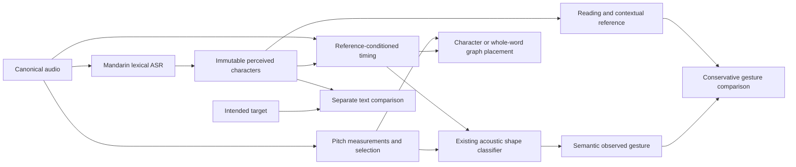
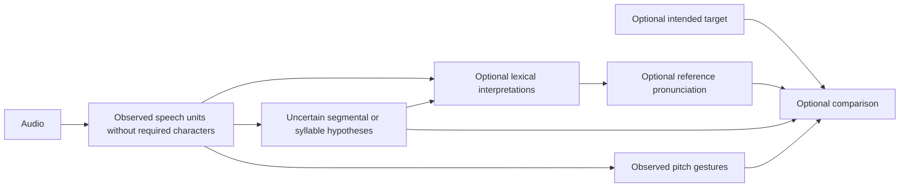

# Current and target architecture

## Current product boundary



The extraction and shape rules are target-independent; their placement still depends on perceived-text timing. This is **not yet independent pre-lexical segmentation**. Dictionary/context pinyin remains a reference reading, never an observed sound label. ASR remains valuable as an immutable lexical interpretation.

**LEXICAL CHARACTER IDENTITY != OBSERVED PITCH GESTURE != REFERENCE TONE != INTENDED TARGET.**

**OBSERVED SEGMENTAL UNIT != LEXICAL CHARACTER IDENTITY.**

## Small additive production contract

`PerceivedSyllable` keeps its existing `observed_contour`, including numeric historical labels, confidence, reason, coverage and features. New read-only computed fields are semantic aliases:

- `observed_gesture`: `level | rising | dipping | falling | unclear`.
- `observed_confidence`: `moderate | low`, inherited from the same classifier.

Only the backend maps `1-like→level`, `2-like→rising`, `3-like→dipping`, `4-like→falling`. Both `neutral-like` and `unclear` map to unclear: there is no independent neutral shape. Computed serialization prevents stored aliases or clients from overriding classifier evidence. No mobile acoustic classifier was added.

The mobile `toneGestureMatch()` presentation object contains `observed_gesture`, `observed_confidence`, `reference_tone` (0/1/2/3/4 or null), and `comparison`. This keeps the product policy on the presentation side while acoustic meaning and provenance remain backend-owned. A reference is not accepted from an unresolved reading. Comparison never accepts intended target or graph geometry. Historical `learnerVerdict()` remains unchanged for laboratory tools.

`PerceivedAnalysisData.timing_groups` contains typed `PerceivedTimingGroup` objects:

```typescript
type PerceivedTimingGroup = {
  character_start: number;  // Source Unicode code-point offset, inclusive
  character_end: number;    // Exclusive; not syllable array index
  text: string;
  start_seconds: number;
  end_seconds: number;
  source: 'azure_word';
  timing_evidence_id: string;
};
```

A shared exact-word validator requires exact ordered lexical correspondence, finite positive in-audio word spans and no overlapping words. Only contiguous multi-Han spans with no internally timed character qualify; another source's character timing must not overlap. Omitted/inserted words fail. No phones, scores, anonymous syllable order, equal split or dictionary reading supplies boundaries. Malformed or mismatching evidence abstains. This is word timing conditioned on perceived identity, explicitly not independently detected syllabification.

Fresh analyses persist groups and split Mine simplification at actual word edges. Existing analyses are enriched from their own saved Azure timing evidence when returned, without persistence mutation, providers or reclassification. Old Mine is retained and clipped conservatively to the saved group span; original full retained/raw evidence stays unchanged. Synthetic analyses cannot supply groups. Raw provider payloads remain internal; the DTO allowlists only the group fields above. No migration or dependency. Analyzer version is `perceived-speech-v5-gesture-groups`; cached old responses remain readable.

## Exact initial comparison policy

Return `uncertain` unless **all** these hold:

1. Trustworthy character timing: finite, nonnegative start and later end; neither grouped nor synthetic evidence.
2. A resolved reading and contextual reference **T1, T2 or T4**.
3. Backend gesture is not unclear and observed confidence is **moderate**.
4. Classifier reason is exactly **`acoustic_shape_only`**.
5. Classified-region `contaminated_fraction < .15`, `tracker_instability_rejected == 0`, and `discontinuous_gap_count == 0` (absent diagnostics inherit the classifier's existing moderate-confidence decision).

Eligible reference expectations are T1→level, T2→rising, T4→falling. An equal gesture is `consistent`; any other eligible gesture is `different`. These are acoustic compatibility statements, not lexical-tone detection or overall pronunciation judgments. Confidence is a heuristic category, not a calibrated probability.

All low-confidence cases stay uncertain, including historical `close`, short coherent falls, onset-core level exceptions, shallow valleys, isolated glitches and coherent-short-gap exceptions. Existing classifier quality gates still own short/sparse/noisy evidence; mobile does not lower them. T3 always stays uncertain when the contextual category is T3, regardless of whether a full valley is observed. A resolved surface T2 from an existing T3-sandhi rule can use the T2 path. Neutral always stays uncertain; no neutral shape requirement is invented. Unresolved contextual T3 chains remain uncertain even with a confident rising observation.

The latest 苹 satisfies every gate and becomes different. Latest 贵 is level-like and differs from T4. Latest 州 fails confidence/reason/contamination/instability and remains uncertain. No label follows from character identity alone.

## Product presentation

Exact observed labels: **level-like**, **rising**, **dipping / valley-like**, **falling**, **unclear**. Numeric tone identities are reference information behind tap only. Default cells remain measured contour plus large perceived character. Whole plot/character backgrounds are subtly positive for consistent, warning for different, neutral for uncertain. An unattributed word uses one neutral outlined group region and testable `grouped_evidence` state. No individual group character receives a positive/warning state.

Accessible character labels say “tone gesture consistent/different/uncertain”; grouped labels additionally state “grouped word pitch, no individual attribution.” Tap states **Observed pitch**, **Observed confidence**, **Reference tone**, and **Tone gesture**, with the lexical reading separately identified. T3 and neutral explain the conservative policy. Group tap explains the real word span and unavailable character attribution. No “Detected tone: T4”, “Correct pronunciation”, or “Wrong pronunciation” is introduced. There is no aggregate correctness score.

## Desired future boundary



The [proposed contract](prelexical-contract.md) allows observed units before any lexical interpretation. Today's character/word-aligned evidence can be linked to it later with explicit boundary conditioning; it cannot be renamed independent evidence. Independent segmental recognition remains missing, not simulated with reference pinyin.
