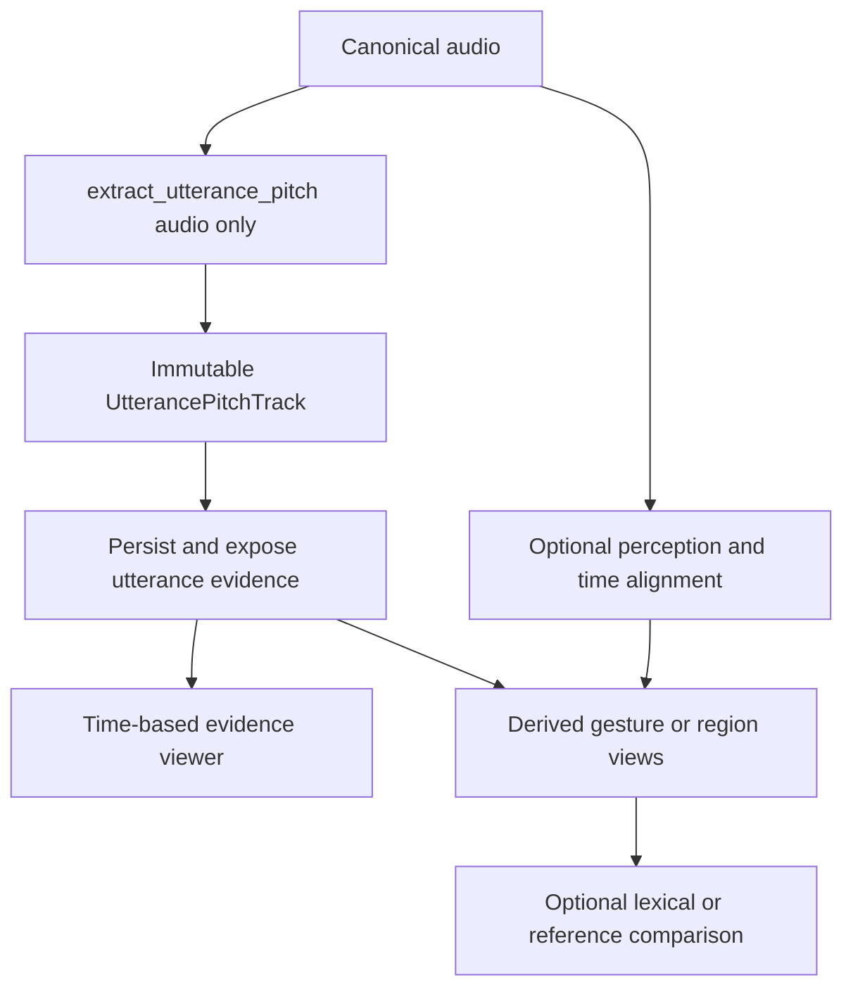

# Acoustic truth boundary

This audit follows the uncommitted production tree. Production code is unchanged by this pass.

## What currently happens

1. `audio/service.py:canonicalize()` converts the uploaded original to mono, 16-kHz PCM16 WAV with ffmpeg. It does not use text. Ingest performs a separate speech-presence check; the original bytes are preserved.
2. `AcousticAnalysisService.prepare()` in `pronunciation/acoustics.py` resolves the canonical asset by utterance/account, selects reuse by acoustic algorithm/version/parameters, and prepares `analyzer.analyze(audio_path)`. Transcript, target, reading, tone and alignment are absent from that interface and reuse key.
3. `PraatAcousticAnalyzer.analyze()` calls `sound.to_pitch_ac()` **once over the whole waveform**, using a 50–550-Hz range and 10-ms cadence. It also computes a whole-waveform 70-Hz high-pass AC comparison. Neither pass crops by characters or syllables. Original selected frequency is preserved as `tracker_f0_hz`; positive-frequency candidate frequencies/strengths are retained.
4. Acoustic filtering also happens globally: an utterance RMS noise-floor gate; 40–80-Hz spectral dominance and high-pass disagreement flags; one bounded terminal-octave ambiguity rejection. `f0_hz` is already energy-gated; it is **not raw Praat output**. `selected_f0_hz` adds quality rejection. No linguistic unit enters these operations.
5. `PerceivedSpeechAnalysisService` requires a successful nonempty perception and calls `require_speech(canonical, transcript=...)`. It constructs lexical syllables/readings, prepares acoustic work, and constructs an `AlignmentRequest` with `reference_text=perception.transcript` and reference pinyin. Acoustic computation and alignment then run concurrently. The acoustic closure has no access to this text or alignment.
6. After both futures return, `display_contour(raw_pitch)` runs once over all acoustic frames. Range/strength/quality checks, bilateral short-island rejection, local Hampel rejection, utterance-relative normalization, and within-region median smoothing remain independent of character regions.
7. Only then does the loop over timing units call `syllable_contour(display,start,end)`, using half-open `[start,end)` ownership. `classify_contour(...,raw=raw_pitch)` separately selects acoustic evidence inside those supplied time boundaries. Region selection, onset/core exclusions and support judgments can therefore change when lexical alignment changes, although the original utterance F0 cannot.
8. `sentence_pitch_evidence(raw,display,syllables,timing_groups)` splits the retained sequence at actual character/group edges **before Mine simplification**. This changes presentation segmentation and simplification vertices. Full retained measurements and original timestamps/frequencies survive in detail/raw. `SentenceToneGraph` maps elapsed times into character/group cells on a shared vertical scale.

## Exact linguistic coupling

There is **no character-conditioned raw estimator or character-dependent whole-utterance selection filter** in the audited primary path. Changing a transcript cannot change the raw numeric pitch result for a fixed waveform, configuration and implementation.

There are nevertheless three later couplings:

- **Availability/scheduling:** the perceived-analysis entrypoint requires successful text first and applies a transcript-aware speech-presence guard. A different transcript can prevent this entrypoint from reaching acoustic computation or publishing a result. This is an availability difference, not a different acoustic estimate. The independent acoustic service already exists.
- **Unit evidence:** perceived text and reference pinyin condition optional alignment, which determines slicing and the observed gesture's evaluation region. These are derived views, not utterance F0.
- **Display geometry:** character/group edges determine Mine segmentation and simplification, followed by cell placement. A changed transcript/alignment can change those vertices without changing the underlying track.

The estimator already meets the numerical character-free invariant. The stricter proposed product order—an accessible utterance evidence object before linguistic processing—is not completely realized by perceived-analysis orchestration. **Decision 4: CURRENT RAW EXTRACTION ALREADY CHARACTER-FREE; ORCHESTRATION REFACTOR ONLY.** Reuse the existing audio-only service; change scheduling and evidence packaging.

## Research contract implemented

`benchmark/pronunciation_v2/f0_foundation.py` defines `UtterancePitchTrack` and `PitchFrame`. Fields are waveform SHA-256, tracker/configuration provenance, input sample rate/duration, native frame cadence, confidence interpretation, and frames containing native time, nullable Hz, nullable confidence, nullable native voicing, and available acoustic candidates.

The estimator accepts only an audio path, a fixed tracker name, and an optional destination for raw network activations. There is no text, character, pinyin, target, expected shape, lexical reading or tone field. A null confidence/voicing flag means unavailable, not zero confidence. CREPE's raw F0 is always returned: its missing native voicing decision is explicit. Runtime and file location stay outside canonical evidence serialization. No confidence is mislabeled a calibrated speech probability.

Praat includes original zero-frequency/unvoiced candidates as well as positive candidates. CREPE stores its full 360-bin activation matrix in local NPZ files and exposes five leading bin activations per frame. pYIN and Harvest retain the public native outputs; inaccessible internal candidate lattices are not fabricated. Candidate sets do not certify a correct fundamental.

Native frame times and F0 are preserved without rounding. Comparison uses nearest native frames only within half a cadence. Missing frames and long gaps are never interpolated. Minimal cleanup is a separate array that can only remove values; production filtering is a separate ablation. Native evidence remains unchanged.

The research dataclasses freeze frame fields and tuple membership. The configuration dictionary is not deeply frozen; production packaging should freeze or copy that provenance too. This prototype is not a completed production persistence/concurrency implementation.

## Gibberish regression

The metadata adapter deliberately forwards only `audio_path`. Tests invoke **each actual estimator three times**, using the same deterministic waveform with metadata for 贵州/广州, 鬼粥/nonsense, and no characters, including conflicting pinyin/tone/expected-contour fields. Canonical JSON bytes must match exactly. Tests also check contract fields, no extrapolation or gap bridging, known-F0 error accounting, deterministic synthesis, and cleanup immutability.

CREPE's upstream Viterbi bin-to-Hz conversion intentionally adds random dithering. The adapter fixes that NumPy seed and restores caller RNG state. CPU inference is deterministic; no text-derived seed or path correction is introduced. Inference batches are concatenated **before one utterance-wide native Viterbi decode**, so batching cannot split the temporal path. This is a research adapter, not a thread-safe production service implementation.

## Smallest future architecture

Schedule acoustic extraction concurrently with ASR after canonical audio is available, and persist the acoustic object independently of perception completion. Preserve native F0, any selection mask, and their producer/configuration separately; avoid calling an already energy-gated field “raw.” Attach text-conditioned time spans afterward. Preserve all missing/ambiguous regions and provenance. Existing acoustic reuse and the audio-only analyzer interface can be reused.

No candidate, including the final RMVPE experiment, qualified for migration. Stop tracker search and design product behavior around partial/uncertain acoustic evidence. Production filters remain unchanged in this evaluation; this does not certify the current foundation. In a future migration, move acoustic confidence/energy selection into a separately versioned utterance view, retain the original measurements, and keep alignment, gesture judgments and Mine simplification downstream. Do not transfer Praat-specific strength, high-pass disagreement, terminal-octave or Hampel thresholds to another estimator without evidence. No current filter is authorized for removal by this bakeoff.

No gesture classifier, comparison policy, silence guard, character timing, ASR, reference rule, color, or renderer was changed here. The existing narrow 要/个 fixes remain intact. A tracker migration, if supported by the final decision, is a later pass.

## Final RMVPE architecture regression

The sixth tracker has the same audio-only entrypoint and immutable research frame contract. Actual historical audio with 贵州, 鬼粥, empty and arbitrary nonsense contexts is byte-identical. Native zero/unvoiced decisions and max-salience confidence are preserved; all 360-bin salience evidence remains separate from the .05 selection view. No alignment or Mandarin metadata reaches the model.

The proposed acoustic truth boundary is unchanged. RMVPE does not qualify for production, so this pass creates no production adapter, scheduling change, filter replacement or migration. The next product pass must work with uncertain/partial observations without per-character tracker switching or tone-informed correction.
